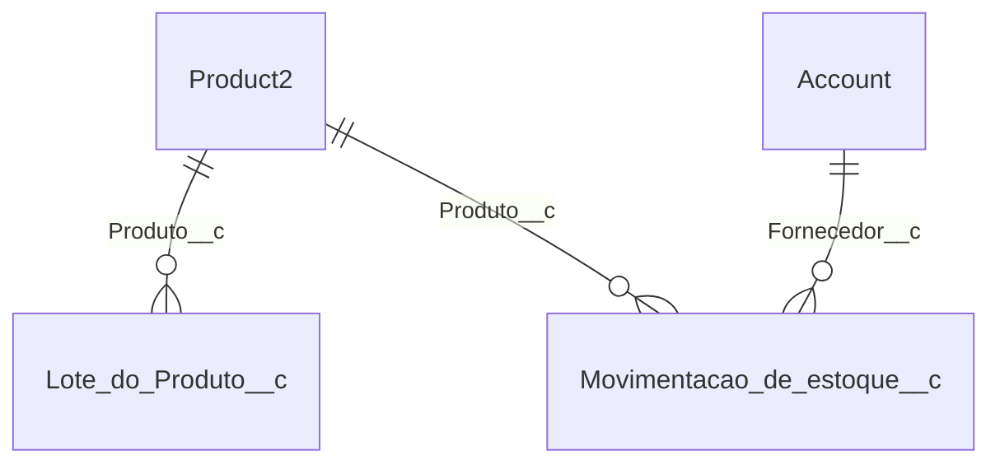

# Modelo de dados

## Entidades

### `Product2` (objeto padrão)

Campos personalizados recuperados: `Categoria_do_produto__c`, `Estatus_de_Estoque__c`, `Estoque_Minimo__c`, `Marca__c`, `Preco_de_Venda__c`, `Preco_de_custo__c`, `Produto_Controlado_por_Validade__c` e `Quantidade_em_Estoque__c`. Os metadados convertidos também contêm campos padrão de produto; eles não são apresentados aqui como campos criados pelo NutriStock.

### `Fornecedor__c`

Campos: `CNPJ__c`, `Email__c`, `Endereco__c`, `Status__c` e `Telefone__c`. Há layout, lista `All`, aba personalizada e tradução `pt_BR`.

### `Lote_do_Produto__c`

Campos: `Data_de_Validade__c`, `Produto__c`, `Quantidade_do_Lote__c` e `Status_do_Lote__c`. `Produto__c` é lookup para `Product2`. Há layout, lista `All`, aba personalizada e tradução `pt_BR`.

### `Movimentacao_de_estoque__c`

Campos: `Data_de_Movimentacao__c`, `Fornecedor__c`, `Motivo__c`, `Observacao__c`, `Produto__c`, `Quantidade__c` e `Tipo_de_Movimentacao__c`. `Produto__c` é lookup para `Product2`; `Fornecedor__c` é lookup para **`Account`**. Há layout, lista `All`, aba personalizada, tradução `pt_BR` e a regra de validação `Bloquear_Saida_Maior_Que_Estoque`.

## Diagrama de relacionamentos confirmados

O diagrama representa os destinos dos lookups nos metadados. Não há evidência de relacionamento direto entre `Fornecedor__c` e `Movimentacao_de_estoque__c`, nem entre lote e movimentação. O campo `Fornecedor__c` da movimentação foi mantido como recuperado e não foi corrigido.

## Regras de dados

A regra ativa `Bloquear_Saida_Maior_Que_Estoque` compara `Quantidade__c` com `Produto__r.Quantidade_em_Estoque__c` para movimentações do tipo `Saída`. A fórmula e a mensagem estão no metadata convertido; a documentação não altera sua lógica.
